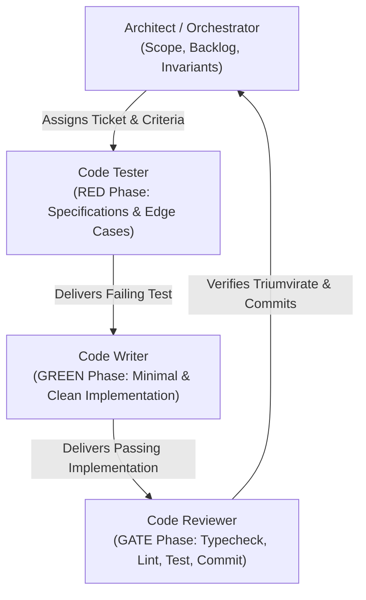
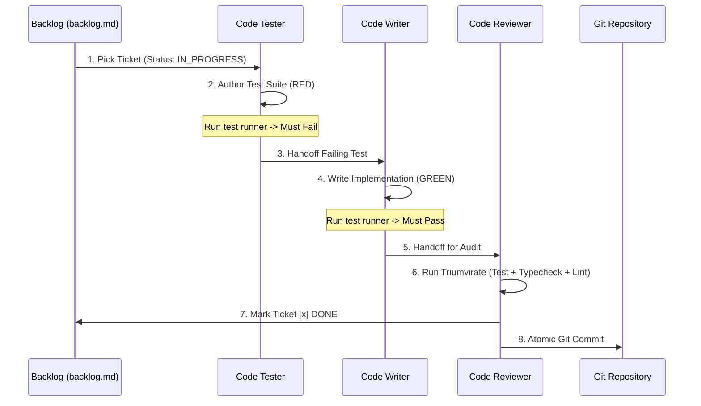

# Universal Agentic Software Engineering Framework (UASEF)
**A Systematic Multi-Agent Workflow, Test-Driven Development Engine, and Token-Efficient Execution Model for AI-Assisted Software Projects**

---

## 1. Executive Summary & Core Philosophy

Building production-grade software with AI agents requires strict engineering discipline. Without structured boundaries, agentic development quickly devolves into uncontrolled code sprawl, hallucinations, context exhaustion, and regressions.

This framework defines a **product-agnostic, multi-agent development methodology** designed to maximize code quality, eliminate regressions, and maintain extreme token efficiency across any software stack (Node.js/TypeScript, Python, Go, Rust, or Mobile).

### The Four Pillars
1. **Test-First Grounding (TDD):** Code is ephemeral; test assertions are the verifiable source of truth. Production code is never written before a failing test exists.
2. **Zero-Token Automated Quality Gates:** LLM tokens must never be squandered on visual syntax verification. Native CLI toolchains (test runners, strict compilers, linters) act as zero-token mechanical gates.
3. **Traceable Living Backlog (`backlog.md`):** State is decoupled from conversational context windows. The backlog is a version-controlled, living specification accessible across agent sessions.
4. **Token Cost Engineering:** Subagent proliferation incurs a ~75% token penalty due to context re-hydration. The framework enforces an in-context role-switching model backed by automated CLI gates, reserving isolated subagents strictly for broad exploratory research.

---

## 2. Specialized Agent Roles & Mental Models

In an agentic workflow, separation of concerns prevents context pollution. Whether running as discrete subagents or through disciplined in-context role adoption, every action belongs to one of four personas:



### 2.1 The Lead Architect / Orchestrator
- **Mental Model:** Systems engineer, backlog owner, scope gatekeeper.
- **Responsibilities:**
  - Decomposes high-level requirements into atomic, sequentially executable sprint tickets.
  - Establishes non-negotiable architectural invariants (data schema integrity, concurrency safety, security boundaries).
  - Maintains `backlog.md` and guards against scope creep.
  - Decides when to pivot, layer, or de-scope features without breaking existing foundations.

### 2.2 The Code Tester Specialist (RED Phase)
- **Mental Model:** Skeptical QA engineer and specification author.
- **Responsibilities:**
  - Writes comprehensive automated tests *before* any implementation code is touched.
  - Asserts functional happy paths, boundary extremes, type invalidity, malformed payloads, and performance budgets.
  - **The Red Mandate:** Must execute the test suite and confirm that the new test fails with the expected error (e.g., missing module, unmet condition) before handing off to the writer.

### 2.3 The Code Writer Specialist (GREEN & REFACTOR Phase)
- **Mental Model:** Focused, pragmatic software craftsman.
- **Responsibilities:**
  - Implements the minimum code strictly necessary to turn failing tests green.
  - Refactors for algorithmic clarity, modularity, and memory efficiency without altering external behavior.
  - Adheres strictly to static type systems (zero `any`, zero `@ts-ignore`, zero unchecked casts).
  - Preserves all unrelated comments, docstrings, and existing module contracts.

### 2.4 The Code Reviewer & Gatekeeper (GATE & COMMIT Phase)
- **Mental Model:** Release engineer, security auditor, and git maintainer.
- **Responsibilities:**
  - Executes the **Verification Triumvirate**:
    1. Automated Test Suite (`npm test`, `pytest`, `cargo test`) $\rightarrow$ 100% passing.
    2. Strict Typecheck (`tsc --noEmit`, `mypy`) $\rightarrow$ Zero errors.
    3. Linter (`eslint`, `ruff`, `clippy`) $\rightarrow$ Zero warnings/errors.
  - Audits code against security vulnerabilities (SSRF, injection, unauthorized mutations, data leakage).
  - Updates `backlog.md` marking the ticket `[x] DONE` with explicit completion details.
  - Crafts an atomic git commit (`feat(...)`, `fix(...)`, `test(...)`) linking directly to the ticket.

---

## 3. The Micro-Sprint TDD Lifecycle

Every feature, bug fix, or refactor follows a deterministic, 5-phase micro-sprint:



### Phase Details

#### Phase 1: Ticket Selection & Invariant Check
- Select the next sequential ticket from `backlog.md`.
- Mark ticket as `[/] IN_PROGRESS`.
- Verify prerequisites and cross-module dependencies before editing files.

#### Phase 2: The RED Phase (Specification Authoring)
- Author tests in dedicated test directories matching source structure (e.g., `tests/domain/`, `tests/api/`).
- Test contracts, not internal implementation details (black-box testing).
- Run test runner: verify test fails for the right reason.

#### Phase 3: The GREEN Phase (Implementation)
- Implement domain models, functions, or route handlers.
- Run test runner: verify all new and existing tests pass.
- Refactor if necessary, ensuring tests remain green throughout.

#### Phase 4: The Automated Quality Gate (Verification Triumvirate)
- Execute the mechanical gate:
  ```bash
  # Example for TypeScript/Node
  pnpm test && pnpm typecheck && pnpm lint
  
  # Example for Python
  pytest && mypy . && ruff check .
  
  # Example for Go
  go test ./... && golangci-lint run
  ```
- Any failure stops the line immediately. No code is committed until all three gates pass cleanly.

#### Phase 5: Backlog Synchronization & Atomic Git Commit
- Update `backlog.md` with:
  - Ticket marked `[x] DONE`.
  - Detailed completion summary (files created, interfaces exported, tests added, benchmarks achieved).
- Stage modified files and make an atomic git commit:
  ```bash
  git add src/domain/foo.ts tests/domain/foo.test.ts backlog.md
  git commit -m "feat(domain): SPRINT-X.Y - implement foo with validation and tests"
  ```

---

## 4. Token Cost Engineering & Context Governance

In large agentic projects, context exhaustion and token burn are the primary causes of degraded reasoning and financial waste. This framework establishes strict token optimization principles.

### 4.1 The Subagent Penalty vs In-Context Role Switching
- **The Problem:** Spawning a subagent requires transmitting the entire system prompt, tool schemas, and environment context. In practice, this incurs a **~75% token overhead** for every routine task and introduces inter-agent synchronization latency and network failure modes.
- **The Rule:**
  - **Do NOT spawn subagents for routine TDD execution.** Adopt Tester, Writer, and Reviewer personas sequentially within the main agent context.
  - **DO spawn subagents for:**
    1. Broad exploratory read-only research across massive external documentation.
    2. Deep parallel search across thousands of files.
    3. Long-running, isolated spike experiments that do not touch main codebase state.

### 4.2 Zero-Token Quality Gates
- Never ask the LLM: *"Can you review this code for syntax or missing imports?"*
- Instead, run the compiler (`tsc --noEmit`, `mypy`). The compiler provides 100% accurate feedback with **zero LLM tokens consumed**.
- If a compiler error occurs, provide the exact compiler stdout back to the writer agent for surgical correction.

### 4.3 Context Compaction & High-Signal Prompts
- Keep workspace files concise and modular. Avoid monolithic files exceeding 500 lines.
- When inspecting files, read targeted line slices (`StartLine`, `EndLine`) rather than whole files.
- Summarize trajectory milestones periodically to prevent context bloat.

---

## 5. Living Backlog Structure (`backlog.md`)

The `backlog.md` file serves as the externalized long-term memory of the project. It persists across agent restarts, context compactions, and session terminations.

### Standard Template for `backlog.md`

```markdown
# Project Backlog: [Project Name]

## Sprint Overview
| Sprint | Focus Area | Status | Target Deliverable |
| :--- | :--- | :--- | :--- |
| **Sprint 1** | **Foundations & Core Architecture** | `[x] COMPLETED` | Scaffolding, tooling, database schema, CI gates |
| **Sprint 2** | **Domain Engine & Business Logic** | `[/] IN_PROGRESS` | Core algorithms, validation rules, serializers |
| **Sprint 3** | **API / Interface Layer** | `[ ] PLANNED` | Endpoints, transports, rate limiting |

---

## Sprint [N]: [Sprint Title]

### SPRINT-[N].[X]: [Ticket Title] (`path/to/module.ext`)
- **Status:** `[ ] TODO` | `[/] IN_PROGRESS` | `[x] DONE` | `[-] BLOCKED`
- **Assigned Roles:**
  - *Tester:* [Specific test cases, boundary assertions, negative scenarios]
  - *Writer:* [Interfaces to export, data structures, implementation scope]
  - *Reviewer:* [Security checks, quality gates, performance constraints]
- **Reasoning Level:** Low | Medium | High
- **Acceptance Criteria:**
  - [Measurable criteria 1]
  - [Measurable criteria 2]
- **Completion Details:**
  - [Appended by Reviewer upon completion: exported symbols, test metrics, git commit hash]
```

---

## 6. Managing Architectural Shifts & Scope Pivots Cleanly

When user requirements or product scope change mid-project, avoid panicked, ad-hoc modifications that break existing code. Follow the **Preserve, Layer & De-Scope Protocol**:

1. **Non-Destructive Schema Evolution (Additive Only):**
   - Never edit or delete historical database migrations (`0001`, `0002`).
   - Introduce changes strictly via new additive migrations (e.g., `0006_...`).
   - Relax constraints (`ALTER COLUMN diet DROP NOT NULL`) rather than dropping tables.
2. **Dormant Preservation Invariant:**
   - When a subsystem is deferred (e.g., complex stateful booking queues deferred to Phase 2), **do not delete its code or tests**.
   - Keep the dormant code and tests untouched. This ensures existing unit test suites remain 100% green without expensive rewrites.
3. **Decoupled Aliasing at the Interface Layer:**
   - If an internal model is named `menu_items` but the product pivots to general services, do NOT perform a high-risk global database rename.
   - Generalize via TypeScript domain aliases and new columns (`kind = 'product' | 'service'`).
4. **Formal Backlog Re-Scoping:**
   - Explicitly document the architectural pivot in `backlog.md`.
   - Update Sprint deliverables: mark deferred tickets as `[ ] DEFERRED (Phase 2)` and insert new sprint tickets for the pivot.
   - Align with the user before resuming implementation.

---

## 7. Universal Project Bootstrapping Checklist

When starting *any* new software project using this framework, execute these setup steps:

- [ ] **Step 1: Scaffolding & Tooling Gate**
  - Initialize project with strict compiler flags (`strict: true`, modern language standard).
  - Configure automated test runner (Vitest, Jest, Pytest) with path aliases (`@/*`).
  - Configure linter and formatter.
  - Verify `test`, `typecheck`, and `lint` scripts execute cleanly from CLI.
- [ ] **Step 2: Initialize `backlog.md`**
  - Author high-level sprint overview and initial Sprint 1 tickets.
  - Define acceptance criteria and test expectations for each ticket.
- [ ] **Step 3: Initial Commit**
  - Commit baseline tooling: `git commit -m "chore(infra): initialize project tooling, test runner, and backlog"`.
- [ ] **Step 4: Execute Micro-Sprint Loop**
  - Pick ticket $\rightarrow$ Tester writes failing test $\rightarrow$ Writer makes test pass $\rightarrow$ Reviewer runs verification triumvirate $\rightarrow$ Update backlog $\rightarrow$ Git commit.
